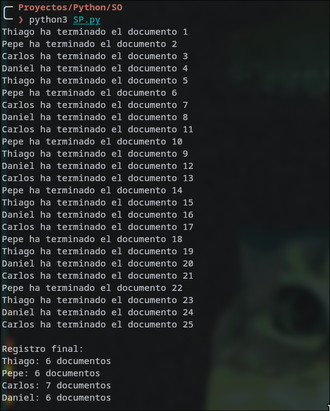
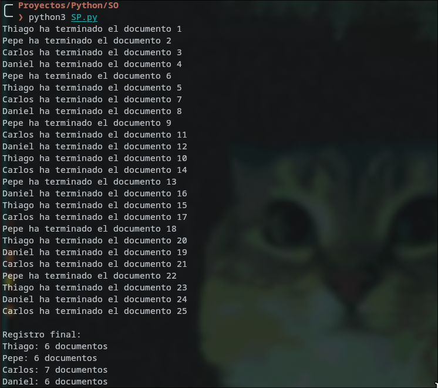
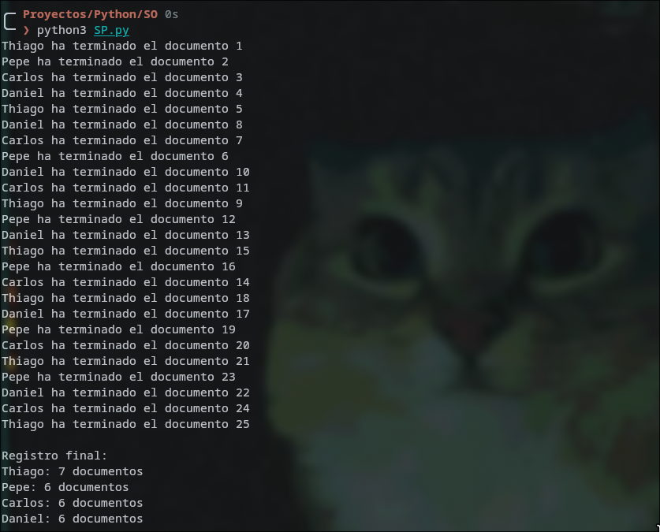
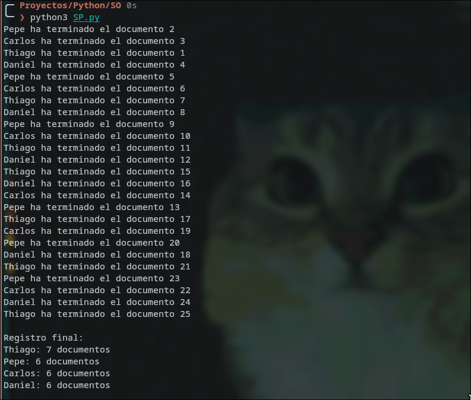

# Práctica SO: hilos con `threading`

`SP.py` reparte 25 documentos entre 4 trabajadores (hilos) usando una `queue.Queue`, protege el diccionario de resultados con un `Lock` y al final imprime cuántos documentos hizo cada uno.

## Ejecuciones

El orden y el reparto cambian entre ejecuciones, pero el total siempre suma 25.

## Preguntas

### ¿Por qué `queue.Queue` es apropiada para compartir trabajos?

Porque nos permite usar `put()` y `get()` los cuales son atómicos (divisibles), también nos ayuda porque usa FIFO, también nos permite usar `get_nowait()`.

### ¿Qué protege `lock` y qué pasaría si se actualizara el resumen sin él?

El lock nos ayuda a proteger los resultados; en el caso del código, protege el diccionario. Sin el lock, quizá en el código si lo quitamos no daría problemas, pero el problema real aparece cuando la operación es leer, modificar y escribir. Lo que significa que se perderían actualizaciones, y al ser 25 documentos, saldrían menos ya que se perdieron actualizaciones.

### ¿Qué cambiarías si cada documento tuviera que guardarse en un archivo real?

Lo primero que nada sería poner el nombre de cada documento diferente, o sea identificándolo. Usaríamos un lock para que no existan pérdidas de actualizaciones, dejaríamos de usar el `time.sleep()` ya que este sería reemplazado por el tiempo real y, por último, usar `try/except` para que si el documento no se terminó de leer no salga como "completado".

## Interpretación por trabajador

| Ejecución | Thiago | Pepe | Carlos | Daniel |
|---|---|---|---|---|
| 1 | 6 | 6 | 7 | 6 |
| 2 | 6 | 6 | 7 | 6 |
| 3 | 7 | 6 | 6 | 6 |
| 4 | 7 | 6 | 6 | 6 |

**Thiago:** hizo 6 documentos en las ejecuciones 1 y 2, y 7 en la 3 y la 4. En casi todas las ejecuciones tomó el documento 1, porque su hilo se inicia primero. Que haya hecho 7 depende de a quién le tocó el último documento, no de ser más rápido.

**Pepe:** hizo 6 documentos en las 4 ejecuciones y nunca recibió el documento sobrante. Su carga fue la más estable. Normalmente tomó el documento 2, justo después de Thiago.

**Carlos:** hizo 7 documentos en las ejecuciones 1 y 2 y 6 en la 3 y la 4. Fue el que se quedó con el documento 25 en las dos primeras. Es el caso contrario a Thiago: lo que gana uno en una ejecución lo pierde el otro en la siguiente.

**Daniel:** hizo 6 documentos en todas las ejecuciones, igual que Pepe. Su hilo se inicia último, pero eso no lo perjudicó.

**Conclusión general:** 25 documentos entre 4 trabajadores da 6 para cada uno y sobra 1. Como todos tardan lo mismo (`time.sleep(0.1)`), el reparto es casi parejo. El único que varía es quien se lleva el documento extra, y eso lo decide el sistema operativo al planificar los hilos. Por eso el orden de los mensajes cambia entre ejecuciones, pero el total siempre suma 25 y ningún documento se repite ni se pierde. Eso confirma que la `Queue` y el `Lock` funcionan bien.
